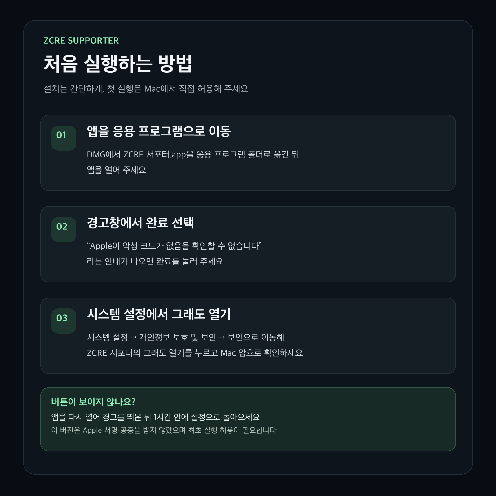

<div align="center">
  

  # ZCRE 서포터

  **작업 곁에, 지크**

  ZCRE의 크레딧과 작업 현황을 바탕화면에서 확인하는 macOS 동반자

  [](https://github.com/datell1357/zcre-supporter/releases/tag/v0.0.3)
  
  
  

  **[다운로드](https://github.com/datell1357/zcre-supporter/releases/tag/v0.0.3)** · [시작하기](#시작하기) · [주요 기능](#주요-기능) · [개인정보와 연결](#개인정보와-연결) · [개발](#개발)
</div>

<br>

## 지크가 작업을 함께 지켜봐요

생성 작업을 기다리는 동안 ZCRE 창을 계속 열어두지 않아도 됩니다. 지크와 메뉴 막대에서 현재 크레딧과 진행 중인 작업을 확인하고, 작업이 끝나면 알림을 받을 수 있습니다.

| | |
| --- | --- |
| **지크를 클릭** | 크레딧·동시 생성 현황과 원형 메뉴를 엽니다. |
| **메뉴 막대를 클릭** | 진행 중 작업, 최근 알림, 서비스 상태를 확인합니다. |
| **작업이 진행 중일 때** | 지크가 노트북 앞에서 일하고, 메뉴 막대에서는 달리는 모습으로 알려줍니다. |
| **작업이 끝났을 때** | 완료·실패 알림과 지크의 반응을 볼 수 있습니다. |

## 주요 기능

<table>
  <tr>
    <td width="50%"><strong>✦ 크레딧과 작업 현황</strong><br><br>사용 가능한 크레딧과 진행 중인 작업을 한눈에 확인합니다. 작업별로 완료 결과를 열고 저장할 수 있습니다.</td>
    <td width="50%"><strong>◉ 지크 원형 메뉴</strong><br><br>이미지·영상 도구와 주짓수·오디오·캔버스로 빠르게 이동합니다.</td>
  </tr>
  <tr>
    <td><strong>↗ 작업 알림</strong><br><br>작업 완료와 실패를 알려줍니다. 작업 종류별 알림과 집중 모드를 설정할 수 있습니다.</td>
    <td><strong>♡ 나만의 지크</strong><br><br>바탕화면 산책과 드래그를 즐기고 크기·효과음을 조절하세요. 지크를 숨겨도 작업 감시는 계속됩니다.</td>
  </tr>
</table>

## 시작하기

1. [v0.0.3 설치 파일](https://github.com/datell1357/zcre-supporter/releases/download/v0.0.3/ZCRE-Supporter-0.0.3-macOS-universal-v3.dmg)을 다운로드합니다.
2. DMG를 열고 **ZCRE 서포터.app**을 **Applications** 폴더로 옮겨 실행합니다. 설치 창에 첫 실행 안내가 표시됩니다.
3. 메뉴 막대의 지크를 눌러 **ZCRE 계정 연결**을 선택하고 로그인합니다.
4. 알림 권한을 허용하면 macOS 시스템 알림도 받을 수 있습니다.

> [!NOTE]
> 이 버전은 Apple Developer ID 서명과 공증을 받지 않았습니다. 최초 실행이 차단되면 실행을 시도한 뒤 **시스템 설정 → 개인정보 보호 및 보안 → 그래도 열기**에서 해당 앱을 허용할 수 있습니다. [Apple 실행 안내](https://support.apple.com/ko-kr/102445)
>
> 파일이 손상되었거나 악성 소프트웨어가 감지되었다는 경고가 나오면 실행하지 말고 다운로드 파일을 확인해 주세요.



로그인 전에는 앱의 **연결 전에 미리 둘러보기**로 가상 작업과 지크를 체험할 수 있습니다. 가상 데이터는 실제 크레딧을 사용하지 않습니다.

## 나에게 맞게 설정하기

- **지크 숨기기 / 보이기** · 캐릭터만 숨기고 메뉴 막대에서 계속 확인할 수 있습니다.
- **산책과 크기** · 자유로운 산책을 켜거나 끄고 지크 크기를 조절합니다.
- **알림과 집중 모드** · 작업 종류별 알림과 조용히 지낼 시간을 선택합니다.
- **효과음** · 붙잡힘과 작업 소리의 음량을 조절하거나 끌 수 있습니다.

## 개인정보와 연결

ZCRE 로그인은 앱 안의 웹 화면에서 직접 진행합니다. 세션 토큰을 앱의 네이티브 코드로 전달하지 않으며, 별도 통계 수집 서버로 사용자 정보를 보내지 않습니다. 최근 알림과 설정은 이 Mac에 저장됩니다. 자세한 내용은 [개인정보 안내](docs/PRIVACY.md)를 확인하세요.

작업은 정상 연결 시 약 **5초**, 크레딧은 평소 **60초**마다 확인합니다. 작업 상태가 바뀌면 크레딧을 추가 확인합니다. 네트워크나 서버 상태에 따라 반영이 늦어질 수 있으며, 앱 종료·Mac 잠자기 중에는 알림을 받을 수 없습니다. [조회·트래픽 안내](docs/OPTIMIZATION-0.2.9.md)

## 개발

macOS 14 이상, Swift 6 / Xcode가 필요합니다. JavaScript 회귀 검사에는 Node.js 20 이상이 필요합니다.

```bash
# 기존 앱을 완전히 종료한 뒤 빌드
bash scripts/build.sh

# 회귀 검사
bash scripts/test.sh
```

빌드 결과는 `dist/ZCRE 서포터.app`에 생성됩니다. 자세한 구조와 배포 절차는 아래 문서를 참고하세요.

- [코드 안내](docs/CODE-GUIDE-KO.md) · [배포 준비](docs/RELEASE.md) · [검증 기록](docs/VERIFICATION.md)
- [기능·기술 참고 자료 (이전 버전 기록)](docs/REFERENCE-0.2.20.md)
- [Windows 개발 현황](docs/WINDOWS.md) — Windows 버전은 별도 개발·검증 중이며 현재 macOS 릴리즈에 포함되지 않습니다.

---

<div align="center">
  <sub>Made for ZCRE creators · <a href="https://www.zcre.co.kr/">zcre.co.kr</a></sub>
</div>
